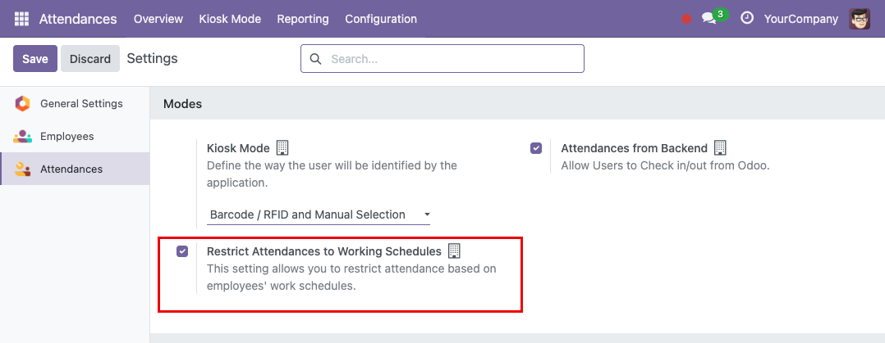
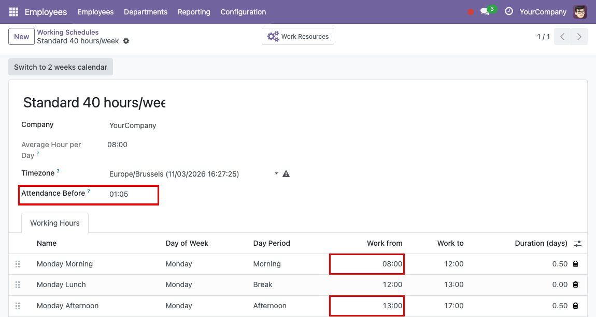
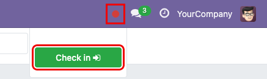
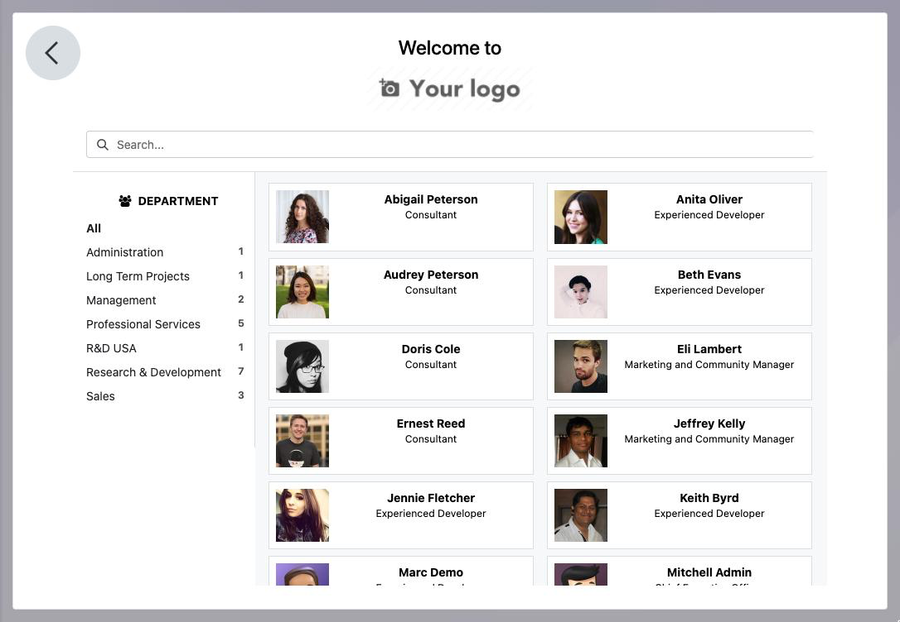
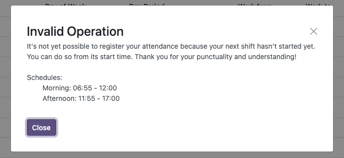

===============================
Hr Attendance Resource Calendar
===============================

.. 
   !!!!!!!!!!!!!!!!!!!!!!!!!!!!!!!!!!!!!!!!!!!!!!!!!!!!
   !! This file is generated by oca-gen-addon-readme !!
   !! changes will be overwritten.                   !!
   !!!!!!!!!!!!!!!!!!!!!!!!!!!!!!!!!!!!!!!!!!!!!!!!!!!!
   !! source digest: sha256:5b02242f5dbe90213a92d0d2632daa7f4c6b7553a8057302a5ab4f1f79657f90
   !!!!!!!!!!!!!!!!!!!!!!!!!!!!!!!!!!!!!!!!!!!!!!!!!!!!

.. |badge1| image:: https://img.shields.io/badge/maturity-Beta-yellow.png
    :target: https://odoo-community.org/page/development-status
    :alt: Beta
.. |badge2| image:: https://img.shields.io/badge/licence-AGPL--3-blue.png
    :target: http://www.gnu.org/licenses/agpl-3.0-standalone.html
    :alt: License: AGPL-3
.. |badge3| image:: https://img.shields.io/badge/github-OCA%2Fhr--attendance-lightgray.png?logo=github
    :target: https://github.com/OCA/hr-attendance/tree/17.0/hr_attendance_resource_calendar
    :alt: OCA/hr-attendance
.. |badge4| image:: https://img.shields.io/badge/weblate-Translate%20me-F47D42.png
    :target: https://translation.odoo-community.org/projects/hr-attendance-17-0/hr-attendance-17-0-hr_attendance_resource_calendar
    :alt: Translate me on Weblate
.. |badge5| image:: https://img.shields.io/badge/runboat-Try%20me-875A7B.png
    :target: https://runboat.odoo-community.org/builds?repo=OCA/hr-attendance&target_branch=17.0
    :alt: Try me on Runboat

|badge1| |badge2| |badge3| |badge4| |badge5|

This module allows you to block attendance based on the employee's work
schedule.

**Table of contents**

.. contents::
   :local:

Use Cases / Context
===================

Some companies need their employees to clock in only within their
assigned working hours, so that attendances match the working schedule
and check-ins made too early or outside a shift are not recorded.

Configuration
=============

The restriction is disabled by default and is set per company:

1. Go to *Attendances* > *Configuration*.
2. In the *Modes* section, enable *Restrict Attendances to Working
   Schedules*.
3. Save.

|CONFIGURATION_RESTRICTION|

Allow entry before a certain time
---------------------------------

1. Go to *Employees* > *Configuration* > *Working Schedules*
2. Create a new working schedule
3. Define in the *Attendance Before* field a time that allows the user
   to perform attendance before the actual time.
4. Save

Example:

- Morning: 8:00 - 12:00
- Afternoon: 13:00 - 17:00

Time allowed before: 1:05

This means that the employee can clock in 1 hour and 5 minutes before
08:00 and 13:00

|ATTENDANCE_BEFORE|

Usage
=====

Validate work date according to assigned schedule
-------------------------------------------------

The validation applies only when the restriction is enabled for the
employee's company (see the configuration section).

Kiosk Mode:

1. Go to *Attendances* > *Kiosk Mode* or Go to attendance icon marked in
   the upper right corner and then click on the button that appears.
2. Select the way to identify yourself
3. Select the employee
4. When you select an employee or click the button, if the current day
   or time doesn't match their work schedule, a message will be
   displayed notifying them of this, and they won't be able to clock in
   at that time. This validation is taken into account at the entrance.

The message tells the employee whether their next shift has not started
yet or their workday has already ended, and lists the periods of the
day, breaks excluded, sorted by start time and including the *Attendance
Before* margin. Checking out is never restricted.

If the working schedule has no periods for the current day, or the
employee has no working schedule, the message only asks the employee to
check their work schedule. The current time is taken in the time zone of
the working schedule, and two-week schedules use the periods of the
current week.

|ATTENDANCE_MENU|

|KIOSK_MODE|

|CHECK_IN_REFUSED|

Known issues / Roadmap
======================

- Time off and public holidays are not taken into account: on those days
  the check-in is validated against the periods of the working schedule
  as on any other day.

Bug Tracker
===========

Bugs are tracked on `GitHub Issues <https://github.com/OCA/hr-attendance/issues>`_.
In case of trouble, please check there if your issue has already been reported.
If you spotted it first, help us to smash it by providing a detailed and welcomed
`feedback <https://github.com/OCA/hr-attendance/issues/new?body=module:%20hr_attendance_resource_calendar%0Aversion:%2017.0%0A%0A**Steps%20to%20reproduce**%0A-%20...%0A%0A**Current%20behavior**%0A%0A**Expected%20behavior**>`_.

Do not contact contributors directly about support or help with technical issues.

Credits
=======

Authors
-------

* Binhex

Contributors
------------

- `Binhex <https://www.binhex.cloud>`__:

  - Edilio Escalona Almira <e.escalona@binhex.cloud>

Maintainers
-----------

This module is maintained by the OCA.

.. image:: https://odoo-community.org/logo.png
   :alt: Odoo Community Association
   :target: https://odoo-community.org

OCA, or the Odoo Community Association, is a nonprofit organization whose
mission is to support the collaborative development of Odoo features and
promote its widespread use.

.. |maintainer-edescalona| image:: https://github.com/edescalona.png?size=40px
    :target: https://github.com/edescalona
    :alt: edescalona

Current `maintainer <https://odoo-community.org/page/maintainer-role>`__:

|maintainer-edescalona| 

This module is part of the `OCA/hr-attendance <https://github.com/OCA/hr-attendance/tree/17.0/hr_attendance_resource_calendar>`_ project on GitHub.

You are welcome to contribute. To learn how please visit https://odoo-community.org/page/Contribute.
