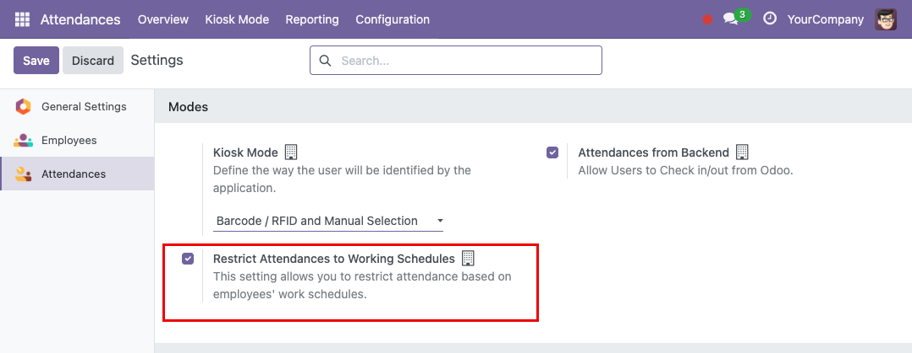
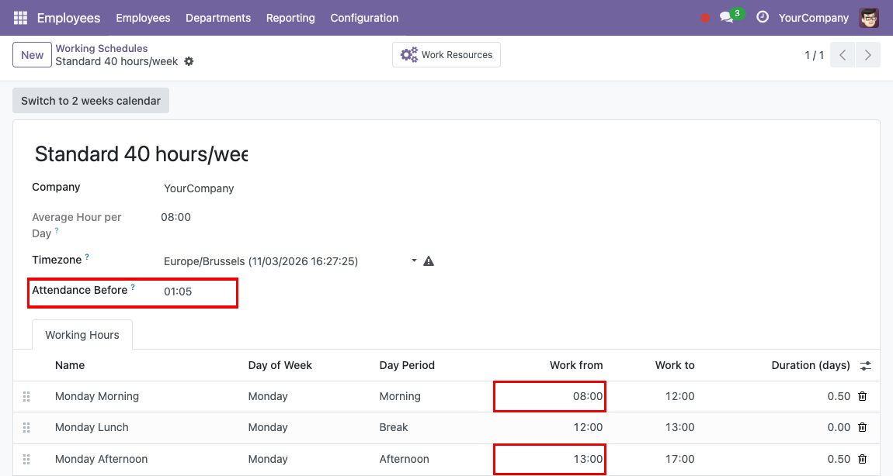

The restriction is disabled by default and is set per company:

1. Go to *Attendances* > *Configuration*.
2. In the *Modes* section, enable *Restrict Attendances to Working Schedules*.
3. Save.

Allow entry before a certain time
----------------------------
1. Go to *Employees* > *Configuration* > *Working Schedules*
2. Create a new working schedule
3. Define in the *Attendance Before* field a time that allows
   the user to perform attendance before the actual time.
4. Save

Example:

- Morning: 8:00 - 12:00
- Afternoon: 13:00 - 17:00

Time allowed before: 1:05

This means that the employee can clock in 1 hour and 5 minutes before 08:00 and 13:00

