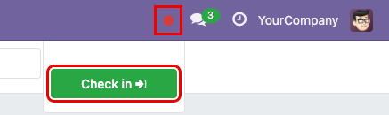
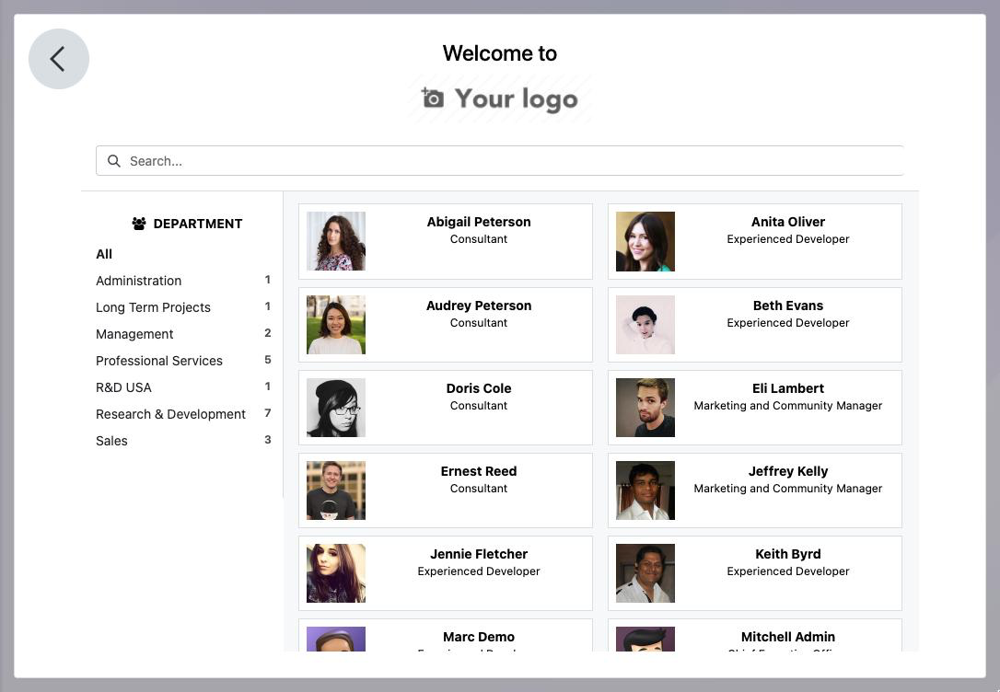
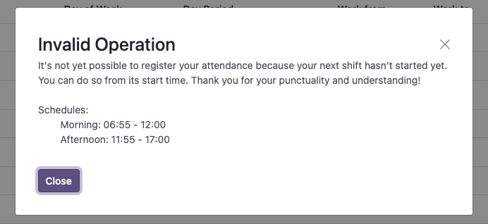

Validate work date according to assigned schedule
---------------

The validation applies only when the restriction is enabled for the employee's
company (see the configuration section).

Kiosk Mode:

1. Go to *Attendances* > *Kiosk Mode* or Go to attendance icon marked in the upper right
   corner and then click on the button that appears.
2. Select the way to identify yourself
3. Select the employee
4. When you select an employee or click the button, if the current day or time doesn't match
   their work schedule, a message will be displayed notifying them of this, and they won't
   be able to clock in at that time.
   This validation is taken into account at the entrance.

The message tells the employee whether their next shift has not started yet or
their workday has already ended, and lists the periods of the day, breaks
excluded, sorted by start time and including the *Attendance Before* margin.
Checking out is never restricted.

If the working schedule has no periods for the current day, or the employee
has no working schedule, the message only asks the employee to check their work
schedule. The current time is taken in the time zone of the working schedule,
and two-week schedules use the periods of the current week.

